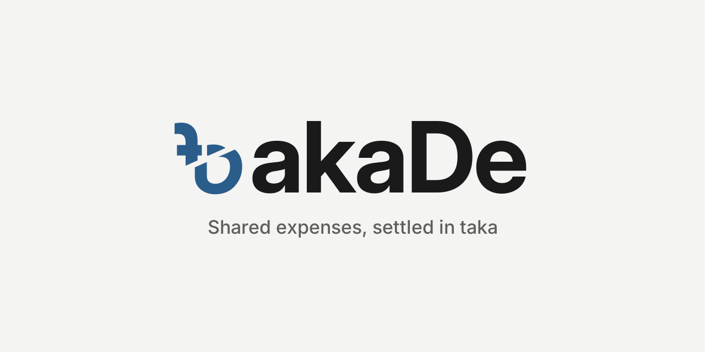

<p align="center">
  
</p>

# TakaDe

A Bangladesh-first app for recording shared expenses, seeing who owes whom, and settling up.
Product rules live in [CLAUDE.md](CLAUDE.md) and the design system in [DESIGN.md](DESIGN.md).

## What exists today

This is the **local-only MVP** foundation. Everything is stored on one iPhone or iPad.

| Area | Status |
|---|---|
| Groups with members (names kept exactly as typed) | Implemented |
| Expenses split equally, by amounts or by shares (older percent and extras splits still count) | Implemented |
| Edit expenses and payments; Activity and History show who changed what, e.g. Amount ৳500 → ৳650 | Implemented |
| Balances and suggested "who pays whom" | Implemented |
| Recording a payment: *recorded by you, not verified*, or *marked received* by the person paid | Implemented |
| Split keypad that does sums (`1200 ÷ 4`) | Implemented |
| Share who-pays-whom to WhatsApp/Messenger as an image and text | Implemented |
| Receipt reading on the phone (camera or photo), reviewed before use | Implemented; accuracy untested on real receipts |
| Layouts that adapt to width: iPhone, iPad, split view, foldables | Implemented with size classes; simulator checks pending |
| Append-only edit history | Implemented |
| English / Bengali switch, Latin / Bengali digits | Implemented; Bengali strings need native review |
| Light and dark color tokens (AA-checked) | Implemented |
| bKash / upay / bank payments | **Not integrated.** No money moves. See [decisions](docs/decisions-needed.md) |
| Android, widgets | Planned next, in that order |
| Sync, accounts, invitations | Not started; decisions needed first |
| Social tab: friends by TakaDe ID, encrypted text messages, live "typing…" | Implemented; needs `supabase/migrations/20261112040000_friend_messages.sql`. No push notifications yet |

## Layout

```
App/                      SwiftUI iOS app (iOS 17+)
  Sources/                Views, app model, theme
  Resources/              Asset catalog (colors), string catalog, fonts
Packages/TakaDeKit/       Swift package, no UI
  TakaDeCore              Money, splits, balances, settlements (no dependencies)
  TakaDePersistence       SQLite storage via GRDB, migrations, audit log
docs/adr/                 Architecture decision records
docs/decisions-needed.md  Open product decisions
project.yml               XcodeGen spec (the .xcodeproj is generated, not committed)
```

## Running it

Requires a Mac with Xcode 16 or later.

```bash
brew install xcodegen
xcodegen generate
open TakaDe.xcodeproj
```

Tests for the ledger and storage:

```bash
cd Packages/TakaDeKit && swift test
```

CI runs both on every push (see `.github/workflows/ci.yml`).
